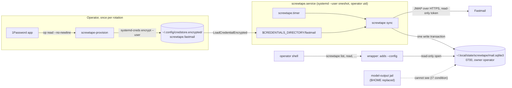
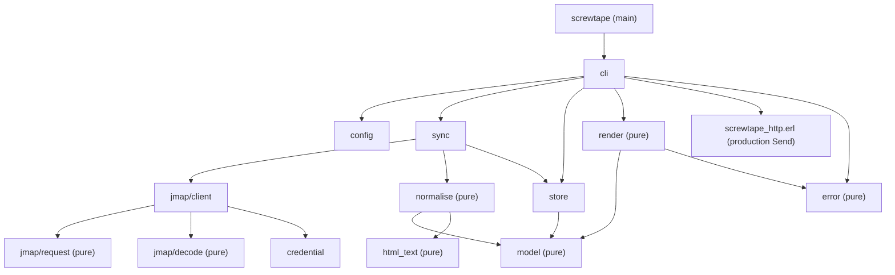
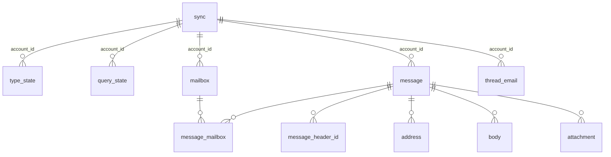
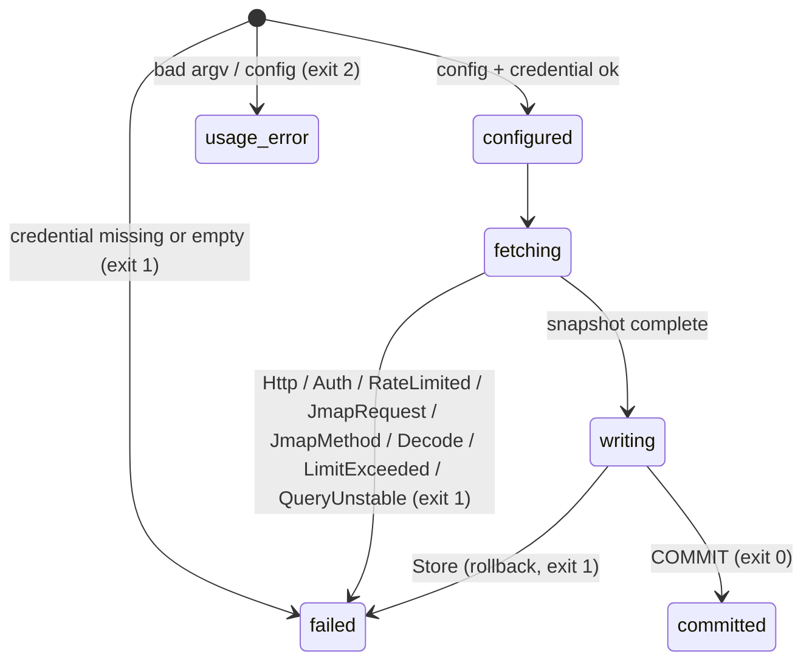

<!-- doctrine:section sec-1 -->
# Design SL-001: Screwtape M1, Gleam JMAP mirror with full bounded sync

## 1. Design Problem

Screwtape is Belphegor's mail mirror. Belphegor is the read-only mail
subsystem for SATAN, deliberated in satan's RFC-020. This slice builds
milestone 1 (RFC-020 D8): a Gleam program on BEAM, the Erlang VM, that copies
a bounded window of the operator's Fastmail mail into a local SQLite store.

It uses JMAP, Fastmail's JSON mail protocol: RFC 8620 for the core and
RFC 8621 for mail. A systemd timer runs it as a oneshot, a service that
starts, syncs and exits. People read the store through a small JSON CLI.

What changes:

- **New program.** This repo has a flake and a devshell, but no Gleam code
  yet. M1 adds:
  - a JMAP client limited to five calls;
  - a normalised message model;
  - the SQLite store;
  - HTML-to-text conversion;
  - the CLI.
- **New deployment.** A Home Manager module exported from this repo
  provides:
  - a hardened `systemd --user` oneshot service and its timer, running as
    the operator;
  - a provisioning command that puts the Fastmail token into a user-scoped
    encrypted systemd credential;
  - a `screwtape` wrapper that supplies the generated config.

  `~/flakes` enables the module and sets the host facts.
- **New jail regression check in satan.** It fails the build if a jail that
  holds model output binds the `op` wrapper, a 1Password socket, or a
  directory above one. It guards known paths; it does not prove the full
  NF-004 boundary (§ 9).

Why it matters: Screwtape is the only process that ever holds a mail
credential. Every later Belphegor consumer reads only the store. M3's triage
tools are one; the human CLI is another. So the credential, the store's
access boundary and its schema are the foundations the later milestones build
on.

The boundary of this design:

- **In.** Full bounded sync, the store schema (ready for M2 and M4), the read
  CLI, the deployment module, token custody and the satan check.
- **Out.**
  - Incremental sync (M2).
  - Anything SATAN-side: `mail_*` tools, triage and the contract form, which
    is RFC-020 OQ-11 (M3).
  - Proposals and Wormwood (M4).
  - Attachments, sending, full-text search and retention policy.

<!-- doctrine:section sec-2 -->
## 2. Current State

- **This repo** has no Gleam sources. `flake.nix` defines:
  - a devshell with gleam 1.19.2, OTP 28, rebar3, sqlite and just;
  - the `quotient-read` and `quotient-write` delegate forms, and their
    check (CHR-001).

  It has no `packages.screwtape`, no test check and no deployment module.
  `justfile` has only `quotient-forms`.
- **`~/flakes`.** The closest precedent is the LLM gateway
  (`features/agents/gateway.nix`, `gateway/llm-gateway`). It is a NixOS
  system service under a static system user, with hardening, a 0700
  `StateDirectory` and `LoadCredentialEncrypted=`. Its admin CLI provisions
  credentials by piping `op read --no-newline <ref>` into
  `sudo systemd-creds encrypt --with-key=host+tpm2 --name=<id>`, then:
  - it stages the result and moves it into `/etc/credstore.encrypted/` only
    if both steps succeed;
  - its admin verbs re-execute under `sudo -u llm-gateway` (DEC-050 there).

  attrd (`features/satan/attrd.nix`) is the precedent for a Home Manager
  module that the app's own repo exports and `~/flakes` only enables.
  `~/flakes` features already define `systemd --user` oneshots and timers
  under a `homeManager` key (for example `features/attention.nix`).
- **The operator's mail is already on disk.** Gnus (`~/Mail`, `~/News`),
  Thunderbird and the Fastmail flatpak keep copies, and the flatpak likely
  holds a full-access session, all readable by the operator's uid. The
  operator's jails run as the operator's uid, with `$HOME` replaced by a
  persisted directory under the `agents` user, so jailed processes see none
  of it, subject to I7's launch condition (§ 5.5). This
  is why DEC-016 treats the jail, not a separate uid, as the boundary.
- **satan.** `just check-jails` builds four flake checks. One of them,
  `runner-socket-unjailed` (`flake.nix`), iterates every `jailPkgs` launcher,
  and the inner launcher each one execs. It fails on any forbidden literal,
  and fails if it scanned no launchers at all. Nothing yet forbids the
  1Password `op` wrapper or the app's sockets.
- **RFC-020 D3** still says the token is resolved from `op://` when the unit
  starts. The research showed that this prompts on every run (SL-001 research
  P10), so DEC-001 supersedes it for Screwtape. Updating the RFC text is a
  follow-up (DEC-015).

<!-- doctrine:section sec-3 -->
## 3. Forces & Constraints

Binding, from satan's governance (the operator confirmed this set as the
governing context for the design):

- **POL-001.** Rust is the language for daemons in SATAN's orbit. Screwtape is
  a oneshot, not a daemon, so Gleam stands (RFC-020 D2). The policy wants a
  disable switch; for Screwtape it is the module's `enable` and the timer.
- **SPEC-002 NF-001 (REQ-013).** Screwtape is the only owner of the store's
  schema. It has one migration ledger, and no consumer ever migrates it.
- **SPEC-002 NF-004 (REQ-016).** No jail that holds model output may get a
  path around the protocol. 1Password access counts as such a path.
- **SPEC-002 NF-006 (REQ-018).** No host literals in code. The store path,
  the credential name and the session URL come from deployment
  configuration.
- **Host facts** (the unit, uid and paths) are recorded in `~/flakes/SATAN.md`.

External facts (research, ✓ rows):

- Fastmail's session URL is `https://api.fastmail.com/jmap/session`, with
  `Authorization: Bearer`. A "Read-only access" token scope exists. Fastmail
  publishes no numeric request caps or rate limits, so the limits must be
  read from the live session (F1, F2, F4, F5).
- A server may clamp the `limit` of a `/query`. `maxBodyValueBytes`
  truncation is UTF-8-safe and flagged by `isTruncated` (F9, F10). An
  HTML-only message presents its HTML in `textBody` (F11).
- No JMAP client exists for Gleam or Erlang (L1). The libraries are
  `gleam_httpc`, `gleam_json`, `sqlight` (over the esqlite C NIF, a native
  Erlang extension) and `htmgrrrl` (L2–L5).
- The NIF forces an erlang-shipment rather than an escript, and rebar3's
  `pc` plugin in the Nix builder (L8, L9).
- `op` resolved at unit start prompts on every run (P10). The gateway
  pattern avoids that (P11).

Operator decisions: DEC-001 (token custody), DEC-004 (the Home Manager
module in this repo), DEC-016 (a user unit running as the operator) and
DEC-017 (direct reads, no sudo). DEC-016 and DEC-017 supersede DEC-002 and
DEC-003, which put Screwtape under a separate uid.

<!-- doctrine:section sec-4 -->
## 4. Guiding Principles

1. **One credential holder, closed by construction.** Only the sync process
   ever sees the token. It arrives as a credentials file, is wrapped as an
   opaque value, and is used in exactly one place: the authorization header.
2. **A pure core with one effect seam per resource.** Parsing, request
   building, decoding, normalisation, HTML-to-text and bounds arithmetic are
   pure. The outside world is reached through three places:
   - HTTP, through one injected `Send` function;
   - SQLite, through `store`;
   - the clock and the filesystem, at the CLI edge.
3. **Bounded everywhere, explicit when a bound is hit.** Each bound is either:
   - the definition of the window (`max_messages`, `max_age_days`);
   - recorded per message (body truncation);
   - or a safety ceiling whose breach fails the run and leaves the store
     unchanged.

   Nothing is cut off silently.
4. **The store is a snapshot of the window, replaced atomically.** A run
   either commits a complete new snapshot or changes nothing.
5. **Schema for later milestones, behaviour for this one.** M1 stores JMAP
   state strings and provenance it does not yet use, so M2 and M4 need no
   schema break. The tables stay private, so a versioned contract can be
   layered over them (RFC-020 OQ-11).
6. **A thin client, not a library.** Five JMAP calls, no pass-through.
   Wormwood may reuse `jmap` and `model` later, but nothing is generalised
   ahead of that.

<!-- doctrine:section sec-5 -->
## 5. Proposed Design

### 5.1 System Model

This diagram shows ownership across the host. Who holds the credential and
who can open the store are the load-bearing edges.



The edges that aren't obvious:

- **Provisioning runs as the operator.** It is the only place `op` is called.
  The token goes straight from `op read` into `systemd-creds encrypt --user`
  and is never seen by Screwtape's code. Screwtape ships the command as a
  script in the module: it stages the credential and moves it into place
  only if both steps succeed. That is the gateway's procedure, at user
  scope.
- **The jail boundary is the `$HOME` shadow.** The store and the credential
  live under `$HOME`, which the operator's jails replace with their own
  bind. Only a jail that breaks I7's launch condition (§ 5.5) would see
  them. The operator's unjailed processes can read the store, as they can
  already read the same mail in Gnus and Thunderbird (DEC-016).
- **M3 consumers aren't drawn here.** If they run as the operator, they read
  the store directly; OQ-11 fixes the contract's form.

Modules in this repo. Arrows point from a module to what it imports, and the
pure modules are marked (DEC-006):



| Module | Responsibility | Effects |
|---|---|---|
| `screwtape` | `main`: silence the logger, run `cli.run` under `guard`, write its output, then `halt(code)` | process exit (FFI) |
| `screwtape/cli` | parse argv into a `Command`; dispatch it; map the result to an exit code | reads config and credential files; reads the clock |
| `screwtape/config` | decode the JSON config and validate the window and bounds | none (it takes text) |
| `screwtape/credential` | the opaque `Token`; read it from the credentials directory | reads one file |
| `screwtape/jmap/request` | build the session and API request bodies, including back-references | none |
| `screwtape/jmap/decode` | decode the session, the method responses, and request- and method-level errors | none |
| `screwtape/jmap/client` | `session/2` and `call/3` over the injected `Send`; enforce the byte budget | via `Send` |
| `screwtape/model` | the normalised types: `Mailbox`, `Message`, `Address`, `Body`, `Attachment`, `Provenance` | none |
| `screwtape/normalise` | turn JMAP objects into model values, with HTML bodies converted | none |
| `screwtape/html_text` | the htmgrrrl SAX fold that turns HTML into text | none |
| `screwtape/sync` | orchestrate session → mailboxes → paged query and get → threads → snapshot | via the client and store |
| `screwtape/store` | open the store, migrate it, write the snapshot transaction, run the read queries | SQLite |
| `screwtape/error` | the single `Error` type and its JSON diagnostic | none |
| `screwtape/render` | the JSON output envelopes for each verb | none |
| `screwtape_http.erl` | the production `Send`: synchronous `httpc` with a per-request body cap, no retries or redirects, and TLS verification (§ 5.2) | network |
| `screwtape_ffi.erl` | `halt/1`, `silence_logger/0`, `guard/1` | process exit; logger |

<!-- doctrine:section sec-6 -->
### 5.2 Interfaces & Contracts

#### Configuration (DEC-009)

The Home Manager module generates one JSON file with `builtins.toJSON`, and
the wrapper and the unit both pass it as `--config <path>`. It sets
`store_path` from `xdg.stateHome`. The unit's `StateDirectory` resolves
from the user manager's own default, `~/.local/state`, so the module
asserts that `xdg.stateHome` is that default. A customised value fails
evaluation instead of splitting the two paths (RV-001 F-31).
Nothing else is read from the environment, apart from systemd's
`CREDENTIALS_DIRECTORY` during `sync`.

```json
{
  "session_url": "https://api.fastmail.com/jmap/session",
  "credential_name": "fastmail",
  "store_path": "/home/operator/.local/state/screwtape/mail.sqlite3",
  "window": { "mailboxes": ["inbox"], "max_age_days": 30, "max_messages": 2000 },
  "max_body_bytes": 262144,
  "max_pages": 20,
  "max_total_bytes": 268435456,
  "request_timeout_ms": 30000
}
```

`config.parse` checks:

- `mailboxes` is non-empty. Each entry matches a mailbox's role first (as in
  `inbox`), and its name otherwise.
- At least one of `max_age_days` and `max_messages` is set.
- Every number is positive.
- `session_url` is `https`.
- `ca_file`, which is optional, is an absolute path. When it is set, the
  transport trusts that CA bundle instead of the system CAs (DEC-018). Tests
  point it at a CA generated per run; the module may point it at the Nix
  `cacert` bundle.

A failure is `Error.Config`, which exits with code 2.

`max_body_bytes` bounds the **total** stored body text of one message,
summed over its parts after HTML conversion (RV-001 F-9). It is also passed
to the server as `maxBodyValueBytes`. That limit applies to each part
separately, so no single part can exceed the message bound, but several
parts together can. The cumulative bound is enforced in `normalise` (§ 5.5).
`max_total_bytes` bounds every HTTP response body received in the run,
summed. The transport refuses a response whose body would exceed what is
left, before buffering it (§ 5.2, production `Send`).

#### CLI (DEC-011)

```text
screwtape --config <path> sync
screwtape --config <path> mailboxes
screwtape --config <path> list [--mailbox <id|role|name>] [--since <YYYY-MM-DD>]
                               [--from <substring>] [--unread]
                               [--limit <1..500, default 50>] [--offset <n>]
screwtape --config <path> read <message-id> [--max-bytes <n>]
screwtape --config <path> thread <thread-id>
```

The installed `screwtape` wrapper only adds `--config <generated path>` and
execs the real binary (DEC-017).

**`sync` is service-only** (RV-001 F-18). It runs only as the
`screwtape.service` user unit, where systemd serialises runs. A manual sync
is `systemctl --user start screwtape.service`. Run from a shell, `sync`
finds `$CREDENTIALS_DIRECTORY` unset and fails with `Error.Credential`.

- **stdout** carries exactly one JSON document per invocation, in the
  envelope `{"version": 1, "kind": "<verb>", "data": …}`.
- **stderr** carries JSON lines:
  `{"level":"error","error":"jmap_method","method":"Email/get","type":"serverFail"}`.
- **Exit codes:** 0 for success, 1 for a runtime failure (network, JMAP,
  store, a ceiling hit), and 2 for a usage or configuration error.

Example output from `sync`:

```json
{"version":1,"kind":"sync","data":{
  "account_id":"u1234","synced_at":"2026-10-26T09:00:00Z",
  "mailboxes":12,"messages":1874,"threads":1502,
  "truncated_bodies":3,"not_found":1,"conversion_failures":0,
  "states":{"Email":"J8","Mailbox":"J2","Thread":"J8"},
  "is_read_only":true}}
```

Example output from `list`:

```json
{"version":1,"kind":"list","data":{"offset":0,"limit":50,"items":[
  {"id":"Mabc","thread_id":"Tq1","received_at":"2026-10-25T21:04:11Z",
   "subject":"Invoice","from":[{"name":"Acme","email":"billing@acme.test"}],
   "preview":"Your invoice…","is_seen":false,"is_flagged":false,
   "mailbox_ids":["Minbox"],"has_attachment":true}]}}
```

`read` adds headers, the `Message-ID`/`In-Reply-To`/`References` lists,
bodies (`source_type`, `text`, `is_truncated`, `is_encoding_problem`,
`conversion_failed`), attachment metadata and provenance (`account_id`, the
Email state at fetch time). If `--max-bytes` truncates the text it prints,
the output marks it with `output_truncated: true`. `thread` lists the
thread's message ids in order, with a `list`-shaped summary for each message
held in the store, and `in_store: false` for those outside the window.

The `version` field anticipates the contract RFC-020 OQ-11 will fix. M1 does
not promise that this CLI is the contract.

#### Key Gleam signatures

```gleam
// screwtape/credential
pub opaque type Token { Token(reveal: fn() -> String) }
pub fn read(dir: String, name: String) -> Result(Token, Error)  // Error.Credential
pub fn bearer(token: Token) -> #(String, String)                // the only call to reveal
```

`string.inspect` of a `Token` renders as `Token(//fn(){…})`, so a `Token`
that leaks into a debug print still hides the secret.

The closure doesn't cover crashes. A Gleam `let assert` failure, or an
Erlang `function_clause` error, prints the offending value or the call's
arguments. An `httpc` worker that crashes logs a report holding its
request. Any of these, inside a frame that holds the revealed header, would
print the token. Three rules contain crashes:

- `main` sets the OTP logger's primary level to `none`, through
  `screwtape_ffi:silence_logger/0`, before anything else runs.
- `main` runs `cli.run` inside `screwtape_ffi:guard/1`. That catches any
  exception and emits only `{"level":"error","error":"internal"}`, then
  exits with code 1.
- No `let assert` or `panic` appears in `credential` or `jmap/client`.

Two more channels can carry process memory out. If the VM itself crashes,
it writes `erl_crash.dump`; a core dump holds the same memory. The unit
sets `ERL_CRASH_DUMP_SECONDS=0` and `LimitCORE=0` to close both (§ 5.4).

```gleam
// screwtape/jmap/client
pub type HttpFailure { Timeout  ConnectFailed  TlsFailed  BadUtf8  TooLarge }
// The second argument caps the response body bytes this call may receive.
pub type Send = fn(Request(String), Int) -> Result(Response(String), HttpFailure)

pub type Client {
  Client(send: Send, token: Token, session: Session, budget: Budget)
}
pub fn session(send: Send, token: Token, url: String, budget: Budget)
  -> Result(Client, Error)
pub fn call(client: Client, calls: List(Invocation))
  -> Result(#(Client, List(MethodResponse)), Error)   // Client carries the spent budget

// screwtape/jmap/decode
pub type Session {
  Session(api_url: String, account_id: String, is_read_only: Bool,
          max_objects_in_get: Int, max_calls_in_request: Int)
}
```

**The production `Send`** is `screwtape_http.erl`, a small FFI module that
makes one synchronous `httpc:request/4` call. `gleam_httpc` doesn't fit,
because it exposes neither of the first two options below (RV-001 F-12).
`max_body_size` goes in the fourth argument (`Options`); the others go in
the third (`HttpOptions`). httpc drops an option placed in the wrong list,
and reports that only to the logger, which is silenced. The oversized-body
controls in § 9 would catch a misplaced cap (RV-001 F-29). The request
options are:

- **`{max_body_size, Cap}`**, the cap it was given (RV-001 F-19). In OTP
  28.5's inets, this applies to every status. A `Content-Length` above the
  cap fails with `body_too_big` before any of the body is read
  (`httpc_handler.erl`). A chunked body fails at the first chunk header
  that would pass the cap (`http_chunk.erl`). Both become `TooLarge`.
- **`{autoretry, 0}`** (RV-001 F-20). OTP's default retries a 503 that has
  `Retry-After` without telling the caller. That would hide the first
  response's bytes from the budget and break the no-retry rule.
- **`{autoredirect, false}`**, and the configured timeout.
- **`ssl` options** `verify_peer` with hostname verification, trusting the
  system CA certificates from `public_key:cacerts_get/0`, or `{cacertfile,
  ca_file}` when the config sets `ca_file` (DEC-018).

Every failure maps onto `HttpFailure`, discarding any term that could hold
the request. `Send` returns any status, and `jmap/client` charges the body
to the budget before acting on it.

`Budget` holds the bytes still allowed under `max_total_bytes`. Each
`call` passes the remaining budget as the cap, and `TooLarge` becomes
`Error.LimitExceeded("max_total_bytes")`. When nothing is left, `call`
returns that error without sending, because httpc rejects a cap of 0 with
a crash, which would surface as `internal` (RV-001 F-29).

One kind of response escapes the cap: a body with neither
`Content-Length` nor chunking, which ends when the server closes the
connection. Its handling in inets is unverified, so the design assumes it
is unbounded. The systemd `MemoryMax=` (§ 5.4) contains that case, and
any failure of the cap. It is containment, not the bound.

```gleam
// screwtape/sync
pub fn run(client: Client, store: Store, window: Window, now: Timestamp)
  -> Result(Summary, Error)

// screwtape/store
pub fn open_writer(path: String) -> Result(Writer, Error)  // WAL, busy_timeout; no migration yet
pub fn write_snapshot(w: Writer, snapshot: Snapshot) -> Result(Nil, Error)
  // one BEGIN IMMEDIATE: refuse a newer user_version, migrate, replace all rows, COMMIT
pub fn open_reader(path: String) -> Result(Reader, Error)  // mode=ro; Store error unless the version matches
pub fn read(r: Reader, query: fn(Tx) -> Result(a, Error)) -> Result(a, Error)
  // runs every query of one CLI verb inside a single read transaction
```

#### JMAP usage (scope § 1)

`jmap/request` defines a closed type, `Method { MailboxGet  EmailQuery
EmailGet  ThreadGet }`. Invocations can only be built from it, which is
invariant I6. Every request carries
`using: ["urn:ietf:params:jmap:core","urn:ietf:params:jmap:mail"]`.

- **Session.** A `GET session_url` with the bearer token. The decoder takes:
  - `apiUrl`, which must be `https`;
  - `primaryAccounts["urn:ietf:params:jmap:mail"]`;
  - the `core` capability's `maxObjectsInGet` and `maxCallsInRequest`;
  - the account's `isReadOnly`.

  If the session has no mail capability, that is `Error.JmapRequest`.
- **`Mailbox/get`** with `ids: null`, which fetches every mailbox and returns
  the Mailbox `state`. The same request also carries `Email/get` and
  `Thread/get`, each with `ids: []`. They fetch no objects and return the
  Email and Thread `state` before phase 1 begins (ISS-001). A server whose
  `maxCallsInRequest` is below 3 refuses the request, and the run fails
  with `Error.JmapRequest`.
- **Phase 1, ids** (RV-001 F-10, F-11). The run pages `Email/query`
  requests that fetch ids only:
  - The filter is `{"operator":"OR","conditions":[{"inMailbox":…}, …]}`,
    combined with `after` when `max_age_days` is set.
  - It sorts by `receivedAt` descending, with `collapseThreads: false`.
  - It passes `position` and a `limit` equal to the messages still to
    fetch. The server may clamp the limit (F9).

  Paging stops when the window is full (`max_messages`), when a page comes
  back short, or when `position` reaches `total`. Paging past `max_pages`
  is `Error.LimitExceeded("max_pages")`.

  Every page must return the same `queryState`. If one differs, the
  membership has changed mid-run, so phase 1 restarts from position 0. It
  restarts at most twice; a third mismatch is `Error.QueryUnstable`, and the
  store stays unchanged. A successful phase 1 therefore yields one coherent
  list of ids, matching a single `queryState`. That list is what gets stored.
- **Phase 2, content.** `Email/get` runs in chunks of `maxObjectsInGet`
  over the ids from phase 1. Each id is fetched exactly once. The call asks
  for the model's properties, plus `fetchTextBodyValues: true` and
  `maxBodyValueBytes: max_body_bytes`.

  `fetchHTMLBodyValues` is not needed, because `textBody` already carries
  the HTML part of an HTML-only message (RFC 8621 §4.1.4; F11).

  Ids that come back in `notFound` were deleted after phase 1. They are left
  out of the snapshot and counted in the summary.
- **`Thread/get`**, in chunks of `maxObjectsInGet` over the distinct thread
  ids.

Phases 1 and 2 cost one more round trip per page than a combined
query-and-get request would. That is the price of fetching each message
once, and of a membership list consistent with its `queryState`.

For each type, `type_state` records the **earliest** state observed in the
run. All three come from the first request, the one that carries
`Mailbox/get`:

- `Mailbox`, from `Mailbox/get`;
- `Email`, from the empty `Email/get`;
- `Thread`, from the empty `Thread/get`.

By RFC 8620 §5.2, `/changes` from the earliest state covers everything that
changed during the run. The Email and Thread states must precede phase 1.
A state taken from a phase-2 `Email/get` would already include mail that
arrived after the last query page, and the stored id list would lack it, so
`/changes` from that state would never report it (ISS-001). Taking the
state early has a harmless cost: mail that arrives during the run is
reported again by M2's first `/changes` and stored again.

<!-- doctrine:section sec-7 -->
### 5.3 Data, State & Ownership

Screwtape owns the store and its schema (SPEC-002 NF-001). The schema version
is held in `PRAGMA user_version`, which is the store's one migration ledger.
Migrations run only inside `write_snapshot`'s transaction, together with the
row replacement (RV-001 F-14). So a sync that fails before its commit leaves
both the schema and the data as they were. Before any DDL or delete, the
writer reads `user_version` inside that transaction. If it is newer than the
binary supports, as after a rollback to an older generation, the writer
fails with `Error.Store("schema_mismatch")` and the store is left untouched
(RV-001 F-22). Every older version has a forward migration chain to the
current one. `open_reader` opens the file
read-only. It refuses a missing store, or one whose `user_version` is not
the version this binary expects, with `Error.Store`, and tells the operator
to run a sync. The store runs with `journal_mode=WAL` and `foreign_keys=ON`.

Timestamps are kept twice. The raw JMAP `UTCDate` text is stored for
provenance. An integer, Unix epoch milliseconds parsed at ingestion, is the
key for sorting and filtering (RV-001 F-17). Raw text can't serve as that
key, because RFC 8620 §1.4 allows fractional seconds that may or may not be
present, so text order isn't time order.

The ordering contract is milliseconds, then id (RV-001 F-23). RFC 3339
allows any number of fractional digits, so two receipt times less than a
millisecond apart get the same key. They are then ordered by message id,
which is stable but not chronological. A mail list does not need finer
order, so the extra precision is not kept.



| Table | Key | Columns (beyond the key) | Serves |
|---|---|---|---|
| `sync` | `account_id` | `synced_at`, `api_url`, `window_json`, `max_objects_in_get`, `max_calls_in_request`, `is_read_only` | provenance; the `sync` summary |
| `type_state` | `account_id, type` | `state` (opaque; the earliest one seen in the run, § 5.2) | M2 `/changes` (RFC 8620 §5.1) |
| `query_state` | `account_id, filter_json, sort_json` | `collapse_threads`, `query_state` (the single state phase 1 settled on, § 5.2), `can_calculate_changes` | M2 `queryChanges` |
| `mailbox` | `account_id, id` | `name`, `parent_id`, `role`, `sort_order`, `total_emails`, `unread_emails` | `mailboxes` |
| `message` | `account_id, id` | `thread_id`, `blob_id`, `received_at` (raw), `received_at_ms`, `sent_at`, `subject`, `preview`, `size`, `has_attachment`, `is_seen`, `is_flagged`, `keywords_json`, `email_state` | `list` filters; M4 expected state |
| `message_mailbox` | `account_id, message_id, mailbox_id` | – | `list --mailbox` |
| `message_header_id` | `account_id, message_id, header, position` | `value` | RFC 5322 ids kept apart from JMAP ids |
| `address` | `account_id, message_id, field, position` | `name`, `email` | `list --from` |
| `body` | `account_id, message_id, position` | `part_id`, `source_type` (`text`\|`html`), `text`, `is_truncated`, `truncated_by` (`server`\|`message_limit`), `is_encoding_problem`, `conversion_failed`, `max_body_value_bytes` | `read` |
| `attachment` | `account_id, message_id, part_id` | `blob_id`, `name`, `type`, `size`, `disposition`, `cid` | `read` (metadata only) |
| `thread_email` | `account_id, thread_id, position` | `message_id` | `thread` |

Notes:

- `header` in `message_header_id` is one of `message_id`, `in_reply_to` and
  `references`, and `position` keeps each list's order (F12).
- `field` in `address` is one of `from`, `sender`, `to`, `cc`, `bcc` and
  `reply_to`.
- `thread_email` may name messages outside the window, so it has no foreign
  key to `message`.
- Indexes: `message(received_at_ms)`, `address(email)` and
  `message_mailbox(mailbox_id)`.
- `email_state` is the Email state string of the response that delivered the
  row, as M4 needs (brief §6).
- These tables are private to Screwtape. Names with the prefix `v<N>_` are
  reserved for versioned read views, should OQ-11 choose views.

**The model** (`screwtape/model`) mirrors these tables as Gleam records. For
example:

```gleam
pub type Body {
  Body(part_id: String, source: Source, text: String, is_truncated: Bool,
       is_encoding_problem: Bool, conversion_failed: Bool)
}
pub type Source { PlainText  Html }

pub type Snapshot {
  Snapshot(account: AccountMeta, states: List(#(String, String)),
           query: QueryState, mailboxes: List(Mailbox),
           messages: List(Message), threads: List(Thread))
}
```

**Ownership of state outside the store:**
- The credential: `~/.config/credstore.encrypted/screwtape.fastmail`, a
  user-scoped credential that only the operator's user context can decrypt
  (ASM-005). While a run is live, systemd places the decrypted token in the
  unit's credentials directory under `$XDG_RUNTIME_DIR`, readable by the
  operator's processes. DEC-016 accepts that.
- The config: in the Nix store; it is public and holds no secret.
- The `op://` ref is a public module option.
- Host facts belong in `~/flakes/SATAN.md`.

<!-- doctrine:section sec-8 -->
### 5.4 Lifecycle, Operations & Dynamics

#### One sync run

This diagram shows the order of effects across the process boundary. Note
that nothing is written until every fetch has succeeded (DEC-008).

```mermaid
sequenceDiagram
  participant SD as systemd (timer → oneshot)
  participant CLI as cli
  participant SY as sync
  participant CL as jmap/client
  participant FM as Fastmail
  participant ST as store
  SD->>CLI: screwtape --config C sync (CREDENTIALS_DIRECTORY set)
  CLI->>CLI: config.parse, credential.read, clock now
  CLI->>ST: open_writer (WAL, no migration yet)
  CLI->>SY: run(client, writer, window, now)
  SY->>CL: session
  CL->>FM: GET session_url
  SY->>CL: Mailbox/get + Email/get [] + Thread/get [] (one request)
  CL->>FM: POST apiUrl
  CL-->>SY: mailboxes; Mailbox, Email and Thread states
  loop phase 1: id pages (≤ max_pages, ≤ 3 attempts)
    SY->>CL: Email/query (ids only)
    CL->>FM: POST apiUrl
    CL-->>SY: ids, queryState, clamped limit
  end
  loop phase 2: chunks of maxObjectsInGet
    SY->>CL: Email/get (unique ids)
    CL->>FM: POST apiUrl
    CL-->>SY: emails, notFound
  end
  SY->>CL: Thread/get (chunks)
  CL->>FM: POST apiUrl
  SY->>SY: normalise (html_text for HTML parts) → Snapshot
  SY->>ST: write_snapshot (BEGIN IMMEDIATE, migrate, replace, COMMIT)
  SY-->>CLI: Summary
  CLI-->>SD: stdout summary, exit 0
```

`write_snapshot` does all of this in one transaction:

1. `BEGIN IMMEDIATE`.
2. Refuse a `user_version` newer than this binary supports (§ 5.3).
3. Apply any pending migrations.
4. Delete every row from every data table. That is the whole store, not one
   account's rows, so nothing stale survives an account change (ASM-004).
5. Insert the snapshot, including the `sync`, `type_state` and
   `query_state` rows.
6. Commit.

Any error rolls back the whole transaction, migrations included. A failure
before `write_snapshot` leaves the store untouched, schema included. A second identical run produces the same rows,
not duplicates. Mail that leaves the window drops out of the store.

#### Run outcome

This diagram shows how each failure class reaches the exit status. Every path
except `committed` leaves the previous store as it was.



A rate limit is not retried. The next timer tick is the retry. The unit's
`TimeoutStartSec` puts an upper bound on the whole run, independent of the
timeout on each request.

#### Deployment and operations

- **Provisioning, once per token rotation.** The operator runs
  `screwtape-provision`, a script the module adds to the user's packages. It
  does three things, without sudo:
  - runs `op read --no-newline <ref> | systemd-creds encrypt --user --name=fastmail - <staged>`;
  - if both steps succeed, moves the staged file onto
    `~/.config/credstore.encrypted/screwtape.fastmail`, and otherwise
    removes it;
  - starts `screwtape.service` once with `systemctl --user` and reports its
    result.

  This is the gateway's `credentials` procedure at user scope, with the same
  staging rule. Whether `--user` encryption needs no privilege is part of
  ASM-005.
- **Steady state.** Both units are `systemd --user` units, defined by the
  Home Manager module (DEC-004, DEC-016). `screwtape.timer` uses
  `OnCalendar` (a module option, default `*:0/15`) with `Persistent=true`.
  `screwtape.service` is `Type=oneshot`, with
  `StateDirectory=screwtape` (`~/.local/state/screwtape`, mode 0700),
  `LoadCredentialEncrypted=fastmail:%E/credstore.encrypted/screwtape.fastmail`
  (`%E` is `$XDG_CONFIG_HOME` in a user unit) and `TimeoutStartSec` (a
  module option, default `5min`).

  The user manager has no `network-online.target` (systemd.special(7),
  "Special User Units"), so the unit cannot order after the network
  (RV-001 F-6). A run that starts before the network is up fails to
  connect, exits 1 and leaves the store unchanged. The next tick retries.

  Hardening is the subset that works in a user unit: `NoNewPrivileges`,
  `PrivateTmp`, `ProtectSystem=strict`, `ProtectHome=tmpfs`,
  `RestrictAddressFamilies=AF_UNIX AF_INET AF_INET6`,
  `SystemCallFilter=@system-service` and `UMask=0077` (ASM-005). In a user
  unit, `ProtectSystem=strict` leaves `$HOME` and `$XDG_RUNTIME_DIR`
  writable. `ProtectHome=tmpfs` hides the rest of `$HOME`, while
  `StateDirectory` and the credentials directory stay reachable
  (RV-001 F-28). Two
  settings close the crash-dump channels (§ 5.2): `LimitCORE=0`, and
  `Environment=ERL_CRASH_DUMP_SECONDS=0`. `MemoryMax=` (a module option,
  default `1G`) contains the process if the application bounds fail.

  The timer runs only while the operator's user manager runs. Enabling
  lingering, so that it also runs while the operator is logged out, is a
  host choice in `~/flakes`.
- **Disable switch** (POL-001): `services.screwtape.enable = false` in Home
  Manager.
- **Human reads.** `screwtape list …` runs through the wrapper as the
  operator, with no sudo (DEC-017). Each read verb runs its queries in one
  read transaction (RV-001 F-15), so its output comes wholly from the
  snapshot before a commit or wholly from the one after it.
- **Smoke checks**, recorded in `SATAN.md`:
  - `systemctl --user status screwtape.service`;
  - `journalctl --user -u screwtape`;
  - `screwtape mailboxes`.

<!-- doctrine:section sec-9 -->
### 5.5 Invariants, Assumptions & Edge Cases

**Invariants.** § 9 maps each one to its evidence:

- **I1.** The token's bytes never appear in argv, stdout, stderr, any
  `string.inspect` of an `Error`, or any row in the store. This holds
  through crashes too (DEC-012; crash containment in § 5.2).
- **I2.** A run that does not commit leaves the store byte-for-byte as it
  was, **schema included** (DEC-008, RV-001 F-14).
- **I3.** After a commit, the store holds exactly the window's snapshot:
  - the id list from one `queryState`, minus the ids that came back
    `notFound`;
  - no duplicates;
  - nothing left over from the previous run.
- **I4.** No bound is ever applied silently. Every body the server
  truncated, and every body cut to fit the per-message bound, has
  `is_truncated = true` and a `truncated_by` value: `server` or
  `message_limit`.
- **I5.** `html_text` and `normalise` import nothing that does I/O, so
  converting HTML cannot fetch anything.
- **I6.** No JMAP call outside `Mailbox/get`, `Email/query`, `Email/get` and
  `Thread/get` can be built. Invocations take the closed `Method` type.
- **I7.** The SQLite file and its `-wal` and `-shm` files live under the
  operator's `$HOME`, in a 0700 directory, created with `UMask=0077`, so
  no other uid can open them (DEC-016). Jails run as the operator's uid, so
  only their mount view keeps them out (RV-001 F-27). A jail's `$HOME` is
  its own persisted directory, so it can't see them, **on one condition**,
  called the *launch condition* below. The launcher binds the jail's
  working directory read-write, so that directory must not be, or contain,
  any of:
  - the store's directory, `~/.local/state/screwtape`;
  - the credential's directory, `~/.config/credstore.encrypted`;
  - `~/.config/systemd/user`, where a drop-in would run inside the unit
    that holds the token.

  `$HOME` and its ancestors contain all three, so they are excluded too.
  The operator accepted the launch condition (2026-10-26). A jail launched from
  `$HOME` already sees the operator's other mail and `~/.config`, which is
  a general jail escape, not one particular to Screwtape. The pi-dev `jail`
  wrapper already refuses `$HOME` and its ancestors. It doesn't refuse
  `~/.local`, `~/.config` or the directories under them, and the
  `jailed-agents.nix` launchers have no such guard. `~/flakes` IMP-042
  proposes one guard on every entry point that refuses `$HOME`, its
  ancestors, and anything inside `~/.local`, `~/.config` or `~/.ssh`. That
  enforces the whole launch condition. satan's ISS-028 owns the wider
  question.
- **I8.** Each read verb's output comes from one committed snapshot
  (RV-001 F-15).
- **I9.** Runs never overlap, so a stale run can't overwrite a newer
  snapshot. `sync` runs only as the oneshot user unit (RV-001 F-18).
- **I10.** A writer never alters a store whose schema is newer than it
  supports (RV-001 F-22).

**Assumptions:**

- ASM-001: the esqlite NIF builds offline. Plan phase 1 tests this.
- ASM-002: htmgrrrl's events are enough for the fold.
- ASM-003: the abstract socket is protected by the GID check. This is
  **unvalidated**. The test is a negative probe of the abstract endpoint from
  inside a jail, recording the jail's groups and `no_new_privs`. satan's
  RSK-021 owns it (RV-001 F-21). Seeing which socket `op` uses (host check
  8) only identifies the endpoint (RV-001 F-13).
- ASM-004: there is one mail account.
- ASM-005: a user unit runs the BEAM under the planned hardening, and loads
  a user-scoped encrypted credential. The deployment phase tests this.

**Edge cases:**

- **The per-message body bound.** `normalise` walks a message's `textBody`
  parts in order and keeps a running count of stored text bytes, after HTML
  conversion. A part that would exceed `max_body_bytes` is cut to the
  longest valid UTF-8 prefix that fits, which is a byte bound, not a
  grapheme count. That part is marked `truncated_by = message_limit`. The
  parts after it are stored with empty text and the same mark.
- **Truncated HTML.** `maxBodyValueBytes` can cut HTML mid-tag. The fold
  must tolerate the unclosed element and emit what it has. The body keeps
  `is_truncated` from JMAP, with `truncated_by = server`.
- **Parse failure.** If htmgrrrl fails to parse, the body is stored with
  `text = ""` and `conversion_failed = true`. Its count appears in the
  summary.
- **Membership changes during phase 1.** A `queryState` change restarts
  phase 1, up to two restarts. A third change is `Error.QueryUnstable`, and
  the previous store stands. Ids never repeat within one coherent id list.
- **`notFound` ids.** An `Email/get` can return ids in `notFound`, for mail
  deleted after phase 1. They are left out and counted in `not_found`.
- **Multiple mailboxes.** A message in several window mailboxes appears once.
  The `OR` filter returns it once, and `message_mailbox` records every
  membership from its `mailboxIds`.
- **Mailbox names.** A mailbox name in the config that matches nothing is
  `Error.Config` at sync time, exit 2. A silently empty window could be
  mistaken for success.
- **Clamped limits.** A server-clamped `limit` (F9) shrinks every later page.
  If that pushes paging past `max_pages`, the run fails with
  `LimitExceeded("max_pages")`.
- **`isReadOnly`.** If the account reports `isReadOnly: false`, the sync
  still runs. It records the value and writes a stderr warning (OQ-A in § 6).
- **Fractional seconds.** Timestamps are parsed to epoch milliseconds for
  ordering and for `--since`. Times less than a millisecond apart order by
  id (§ 5.3). An unparseable timestamp is `Error.Decode`.
- **Unicode.** JMAP guarantees valid UTF-8, and `isEncodingProblem` is
  stored. Subjects and names are stored as given.
- **Empty window.** The run commits an empty snapshot and exits 0.
- **No store yet, or an older schema.** A read verb fails with
  `Error.Store("no_snapshot")` or `Error.Store("schema_mismatch")`, exit 1,
  until a sync commits.
- **A newer schema.** After a rollback to an older generation, the writer
  finds a `user_version` it doesn't know. It fails with
  `Error.Store("schema_mismatch")` and changes nothing. Reads fail the same
  way. Rolling forward again, or deleting the store, recovers.
- **Contention.** WAL lets readers proceed during a commit. `busy_timeout`
  (5 s) covers brief lock contention. Ordering between runs comes from I9,
  not from the timeout.

<!-- doctrine:section sec-10 -->
## 6. Open Questions & Unknowns

- **OQ-A: should a non-read-only account fail closed?** The design records
  `isReadOnly` and warns. It is unverified whether Fastmail reports
  `isReadOnly: true` for a "Read-only access" token (F2, host check 9). The
  live run will show it. If it does, the operator may want a later change
  that refuses to sync when the value is `false`.
- **ASM-003's negative probe** (RV-001 F-13, F-21). From inside each class
  of jail that holds model output, attempt to connect to
  `@1PASSWORD_SDK_INTERGATIONS` and record the jail's groups and
  `no_new_privs`. satan's RSK-021 owns the probe and its pass/fail
  criterion. The exposure predates Screwtape, which calls `op` only at
  provisioning, so it does not gate this slice. Host check 8 (which socket
  `op` uses) still helps, but only identifies the endpoint.
- **Lingering.** Without it, the timer runs only while the operator is
  logged in, and `Persistent=true` catches up at the next login. Whether to
  enable it is a host choice in `~/flakes`.
- **Fastmail rate limits** are undocumented (F5). Failing without a retry is
  the M1 answer. The live run will show whether a single sync of the default
  window stays within the limits.
- **RFC-020 OQ-11, the contract's form**, stays open for M3. This design
  keeps both forms possible:
  - CLI JSON carries a `version` envelope;
  - views would use the reserved `v<N>_` prefix.

  An M3 consumer running as the operator can use either form directly. One
  running under another uid would need its own grant.
- **Sync failures are silent.** A failing run shows only in the journal. A
  later change could add an `OnFailure=` notification. M1 doesn't need one.
- **The exact library versions** (`gleam_time`, `htmgrrrl`, `sqlight`/
  esqlite) are pinned in `manifest.toml` in plan phase 1.

<!-- doctrine:section sec-11 -->
## 7. Decisions, Rationale & Alternatives

The decisions are recorded as knowledge records, which you can read with
`doctrine show DEC-NNN`. This table gives only what the design depends on.

| Record | Decision | Main alternative rejected |
|---|---|---|
| DEC-001 | The token is provisioned once into `systemd-creds` and loaded with `LoadCredentialEncrypted=` | `op://` resolved at unit start, which prompts every run |
| DEC-016 | A Home Manager `systemd --user` oneshot running as the operator, with the store in its 0700 state directory under `$HOME` (supersedes DEC-002) | a system unit under a dedicated `screwtape` uid: friction, and little protection, since the operator's uid already reaches the same mail |
| DEC-017 | Reads open the store directly as the operator; the wrapper only adds `--config` (supersedes DEC-003) | a `sudo -u screwtape` re-exec with an authenticating sudoers rule |
| DEC-004 | This repo exports `homeManagerModules.default`; `~/flakes` enables it | an inline unit in `~/flakes` |
| DEC-005 | Plan phase 1 is a packaging walking skeleton | a spike during design, which the code gate forbids |
| DEC-006 | A pure core with one injected `Send` seam | a general-purpose JMAP client |
| DEC-007 | Private normalised tables, state strings and provenance from M1 | a JSON blob per message |
| DEC-008 | Fetch everything, then write once in a single transaction | building a temporary database and swapping it in |
| DEC-009 | One JSON config passed by `--config`; ceilings are errors | environment variables; TOML |
| DEC-010 | The htmgrrrl SAX fold, with no fetch capability | stripping with regexes |
| DEC-011 | Five verbs, a versioned JSON envelope, exit codes 0, 1 and 2; the wrapper adds `--config` | `clip` or `glint` |
| DEC-012 | A credentials file, a closure-wrapped `Token`, sentinel tests | the token in an environment variable |
| DEC-013 | satan's `op-unjailed` launcher scan | mandating `--unshare-net` |
| DEC-014 | One `Error` type, diagnostics of type strings only | free-text errors containing response bodies |
| DEC-015 | Amend the scope now; draft RFC-020 revisions; SPEC-002 at M3 | an SPEC-002 entry now |
| DEC-018 | An optional `ca_file` replaces the system CAs; tests serve TLS from a CA generated per run | http allowed for loopback hosts; I1 tested in-process only |

These choices were made while drafting, within the decisions above:

- **`fetchTextBodyValues` only** (§ 5.2), because of F11.
- **`gleam_time`** for the `now` passed into `sync`. It is Gleam's own time
  package, used instead of an FFI call to the system clock.
- **Ceilings count response bytes, enforced by the transport.**
  `max_total_bytes` counts the bytes of HTTP response body received.
  `screwtape_http.erl`, an FFI module over OTP `httpc`, passes the remaining
  budget as `max_body_size` for every status, and turns off `autoretry` and
  `autoredirect`. `gleam_httpc` is not used, because it exposes neither
  option (RV-001 F-12, F-19, F-20).
- **Two-phase sync.** Phase 1 collects ids under one `queryState`, retrying
  up to twice; phase 2 fetches each id once (RV-001 F-10, F-11).
- **`max_body_bytes` is per message**, enforced cumulatively in `normalise`
  (RV-001 F-9).
- **Migrations run in the snapshot transaction**, the writer refuses a newer
  schema, and readers open read-only (RV-001 F-14, F-22).
- **Epoch-millisecond sort keys**, ties broken by id, alongside the raw
  `UTCDate` (RV-001 F-17, F-23).
- **`sync` is service-only**: it runs only as the user unit (RV-001 F-18).

<!-- doctrine:section sec-12 -->
## 8. Risks & Mitigations

| Risk | Likelihood / impact | Mitigation |
|---|---|---|
| The esqlite NIF won't build offline under nix-gleam (ASM-001) | medium / blocks the slice | Plan phase 1 builds it before any domain code. Fallback 1 is `ESQLITE_USE_SYSTEM` against nixpkgs `sqlite`. Fallback 2 is to consult. |
| `halt` drops buffered stdout | low / truncated JSON | The phase 1 spike checks it; use `erlang:halt(Code, [{flush, true}])`. |
| `httpc` has no CA bundle on NixOS | medium / every sync fails on TLS | The phase 1 spike checks it; if needed, the module sets `ca_file` to the Nix `cacert` bundle (DEC-018). |
| Fastmail rate limits or caps are lower than expected | low / failed runs | Batch sizes come from the session; there is one request at a time; the next tick is the retry. |
| A token leaks through an error path or a crash report | low / high | `Token` wraps a closure; errors carry no requests or bodies; the logger is silenced and `main` guards against crashes; sentinel tests cover every error path and a forced crash (I1). |
| BEAM fails under the user unit's hardening, or a user-scoped credential won't encrypt or decrypt (ASM-005) | medium / the first deploy fails | Validate in the deployment phase by inspecting the journal, and relax only the key that fails. |
| A jail reaches 1Password through the abstract socket (ASM-003, unvalidated) | low / high | The GID check documented by 1Password (P4). satan's RSK-021 owns the negative probe (§ 6). The scan guards the known filesystem paths. |
| `httpc`'s `max_body_size` misses a framing, or the CA setup fails | medium / the byte bound or TLS is broken | The transport phase tests oversized fixed-length and chunked error bodies, and a 503 with `Retry-After`, against `local_jmap` (§ 9), and TLS against a real host. A close-delimited body is contained by `MemoryMax=`. |
| The decrypted token is readable by the operator's processes during a run | accepted | DEC-016: those processes already reach a full-access Fastmail session and the mail itself. The credentials directory is under `/run/user/<uid>`, and the satan scan fails any jail that binds that path or one above it (DEC-013). |
| The new `op-unjailed` check fails on existing jails | medium / satan CI red | That is the intended effect. Any hit is a real NF-004 violation, filed in satan's backlog (SPEC-002 D3). |
| Mail is plaintext at rest | accepted | 0700 under the operator's `$HOME`, readable by the operator's processes and root, as the existing Gnus and Thunderbird copies are. The README says so. |
| Memory use on large windows | low / OOM | The transport refuses bodies above the remaining `max_total_bytes`. `MemoryMax=` contains the process if that fails. |

<!-- doctrine:section sec-13 -->
## 9. Quality Engineering & Validation

The tests are gleeunit tests, written red, green, then refactor. They run
offline under `nix flake check` with no real credentials or mail. Fixtures
are synthetic JSON files under `test/fixtures/`. Most tests replay them
through a fake `Send`, built by the test helper `fixture_send(script)`:

- it matches each request to a response by method name and position;
- it honours the byte cap it is given;
- it records the requests it received, so tests can assert on the wire
  shape.

A second helper, `local_jmap(script)`, serves the same fixtures over TLS
on loopback, which the Nix build sandbox provides. Its CA and server
certificate (SANs `localhost` and `127.0.0.1`) are generated per run by
`public_key:pkix_test_data/1`, and tests set `ca_file` to that CA
(DEC-018), so the production https checks stay in force. Tests use it to
exercise the production `screwtape_http` transport. Its script can
also send raw responses: a chosen status, a `Content-Length` or chunked
framing, a body withheld before its end, and `Retry-After`. It counts the
requests it receives.

**The transport proof comes first** (RV-001 F-19, F-20). The plan's
transport phase must pass these before any later phase relies on the byte
ceiling:

- **Oversized error bodies.** A fixed-length 500 with a body over the cap
  must fail with `TooLarge`, and so must a chunked 500 whose chunks pass
  the cap. In both cases `local_jmap` holds back the end of the body, and
  the `TooLarge` must arrive while it is still holding it. This is the
  negative control: an adapter that buffers before checking, such as plain
  `gleam_httpc`, would wait for the whole body, and the test must fail it.
- **No hidden retry.** A 503 with `Retry-After: 0` must reach
  `jmap/client` as a failure, `local_jmap` must count exactly one request,
  and the 503's body must be charged to the budget.
- **An exhausted budget.** With 0 bytes left, the next `call` fails with
  `LimitExceeded("max_total_bytes")`, and `local_jmap` counts no request.

### Invariant → evidence

| Invariant | Evidence | Kind |
|---|---|---|
| I1 token never leaks | A sentinel token runs through each failure: 401, 403, 429, 500, a timeout, malformed JSON, a method error, an oversized response, and a crash forced inside the client. Each case runs as a subprocess of the built shipment against `local_jmap`. The sentinel must be absent from that subprocess's stdout and stderr, from the inspected errors, and from a `.dump` of the store. `module-eval` asserts `LimitCORE=0` and `ERL_CRASH_DUMP_SECONDS=0`. Provisioning is a short shell pipe, checked by review against the gateway's procedure. | unit, subprocess, eval, review |
| I2 a failed run changes nothing | Failures injected at the session, `Mailbox/get`, each phase-1 page, `Email/get`, `Thread/get` and an insert, plus one run with a pending migration that then fails before its commit. The store's `.dump` and `PRAGMA user_version` are unchanged. A failing migration rolls back too. | unit |
| I3 the store is exactly the snapshot | A repeated run gives identical rows. A message leaving the window is removed. A `queryState` change restarts phase 1, and a third change fails with the store unchanged. Each id is requested exactly once, checked on the recorded wire requests. `notFound` ids are left out. | unit |
| I4 no silent bound | Server-truncated parts are marked `server`. Two parts that each fit but together exceed `max_body_bytes` (plain, and HTML after conversion) are marked `message_limit`, cut at a UTF-8 boundary. `max_pages`, `max_total_bytes` (the transport proof above) and `QueryUnstable` fail the run. | unit |
| I5 no fetch from HTML | `just check-imports`, which runs in the `gleam-test` check, enforces an allowlist of import edges (RV-001 F-24). `model` may import only modules of the `gleam_stdlib` package. `html_text` may also import `htmgrrrl`. `normalise` may also import `screwtape/model` and `screwtape/html_text`. The check resolves each import to its package from the build's package directories, so a `gleam/*` module from an effectful package such as `gleam_erlang` is not mistaken for stdlib. The same three modules may contain no `@external` attribute, so they can't reach Erlang directly either (RV-001 F-30). A conforming fixture must pass. A fixture whose `normalise` imports `gleam/erlang/process` must fail, and so must one whose `html_text` declares an `@external`. | structural |
| I6 only four JMAP methods | `Method` is a closed type; a test checks `method_name` over all four variants. `check-imports` also fails if any module other than `jmap/request` builds an invocation. | type, structural |
| I7 only the operator's uid reads the store; jails can't, under I7's launch condition | `module-eval` asserts `StateDirectory = "screwtape"`, `StateDirectoryMode = "0700"`, `UMask = "0077"`, and a `store_path` under `xdg.stateHome`. After deployment, a smoke check runs `stat` on the store and its `-wal` and `-shm` files. The jail side has no test in this repo: it rests on the jail launcher (outside this repo) and on the accepted launch condition (RV-001 F-27). | eval, deploy |
| I8 one snapshot per read | `read` runs its first query, pauses on an injected hook, and lets a second connection commit a new snapshot. When `read` resumes, its output must be wholly old. | unit |
| I9 runs never overlap | `module-eval` asserts that the unit is `Type=oneshot` and that the wrapper passes only `--config`. A `sync` run outside the unit fails with `Error.Credential` (cli test). Two writers committing in reverse fetch order isn't a supported path, so it isn't tested. | eval, unit |
| I10 no writes to a newer schema | A populated store at `user_version` one above the binary's, including a column the binary doesn't know, must make `write_snapshot` fail with `schema_mismatch`. Its `.dump` and `PRAGMA user_version` must be unchanged; `.dump` alone omits the version. | unit |

### Further cases by module

- **config:** rejects an empty mailbox list, a window with neither
  `max_age_days` nor `max_messages`, a non-positive number and a non-https
  URL.
- **credential:** a missing file, an empty file and a readable file. The
  `inspect` of a `Token` does not contain the secret.
- **jmap/request:** the query filter for one mailbox, for several mailboxes,
  and with `after`. `limit` reflects the remaining count and the clamped
  limit.
- **jmap/decode:**
  - the session (capabilities, primary account, `isReadOnly`), and a session
    without mail;
  - request-level problem documents and method-level `error` responses;
  - malformed JSON and missing fields, which give `Decode` with a path.
- **html_text:**
  - script, style and head are dropped;
  - block elements and `br` become newlines, `li` a bullet, `img` its alt;
  - links become inert text;
  - entities are decoded;
  - truncated mid-tag input still yields text;
  - unparseable input sets `conversion_failed`.
- **normalise:** a multipart/alternative message keeps its text part, and an
  HTML-only message is converted. `isEncodingProblem` is carried through.
  `Message-ID` lists are kept separate. Membership in several mailboxes is
  preserved. Unicode survives intact. Timestamps with and without
  fractional seconds order correctly, and `--since` at midnight includes
  `00:00:00.500Z`. Two times less than a millisecond apart order by id.
- **sync:**
  - pagination across three pages, and an early stop on a short page;
  - a server-clamped limit;
  - an unknown mailbox name;
  - an empty window commits;
  - `type_state` holds the earliest state of each type: the states of the
    first request, not those of any later `Email/get` or `Thread/get`
    (ISS-001).
- **cli:**
  - argv parsing and its usage errors (exit 2);
  - one JSON document on stdout per verb, and JSON-line diagnostics on
    stderr;
  - the `list` filters (`--mailbox`, `--since`, `--from`, `--unread`,
    `--limit` bounds, `--offset`), and `read --max-bytes` setting
    `output_truncated`;
  - read verbs on a missing store, an older schema and a newer one;
  - `sync` outside the unit fails with `Error.Credential`.
- **module-eval:** this check evaluates the Home Manager module in a
  minimal Home Manager configuration, without a VM. It asserts the
  hardening keys (including `ProtectHome=tmpfs`) and `MemoryMax`,
  `LoadCredentialEncrypted`, the state directory and its mode, the timer,
  and the generated config. A configuration with a customised
  `xdg.stateHome` must fail to evaluate. The module's
  source includes no `/home/`, satisfying NF-006. Paths come from
  `xdg.stateHome` and `%E`.

### Outside this repo

- **satan:** `just check-jails` passes with `op-unjailed` added (DEC-013).
  The scan covers each launcher, its inner launcher, and the `--args` and
  runtime-closure files they reference. It forbids the 1Password literals,
  and ancestor binds that would expose them: `/run`, `/run/wrappers` and
  `/run/user/<uid>`. A whole-home bind is out of scope here. For 1Password,
  it exposes only `~/.1password/agent.sock`, the SSH agent, which doesn't
  serve vault items. Since DEC-016 it also exposes Screwtape's store, its
  encrypted credential and `~/.config/systemd/user` (why I7 has a launch condition;
  `~/flakes` IMP-042). The wider home-bind problem is ISS-028. **A positive
  control** is a synthetic launcher with `--ro-bind /run /run`, which must
  make the check fail.

  The scan is a regression guard for known paths, not proof of NF-004
  (RV-001 F-13). ISS-028 owns the wider jail-bypass question. satan's
  RSK-021 owns ASM-003's negative probe (RV-001 F-21).
- **Deployment (ASM-005):** provision, start the unit, and read the journal.
  The unit must succeed under the listed hardening; relax only a key that
  fails, and record which. Then the I7 smoke check.
- **Live acceptance (RFC-020 M1):** after provisioning, one `sync` puts a
  bounded set of real messages in the store. The `Mailbox` and `Email` state
  strings from a separate read-only session, taken before and after the run,
  are equal, which shows the mailbox was not changed. The run also records
  the session's capabilities, `isReadOnly` and `canCalculateChanges` (F2,
  F4, F6, OQ-A).
- **Hygiene:** `gleam format --check`, `gleam build` with no warnings, and
  `nix flake check` all clean. The one accepted exception is the
  "unknown flake output 'homeManagerModules'" warning. attrd's flake, the
  precedent, carries the same warning (RV-001 F-31).

<!-- doctrine:section sec-14 -->
## 10. Code Impact

**This repo** (design targets):

| Path | Change |
|---|---|
| `gleam.toml`, `manifest.toml` | new: the package `screwtape`, its dependencies (`gleam_stdlib`, `gleam_http`, `gleam_json`, `sqlight`, `htmgrrrl`, `argv`, `gleam_time`, `gleam_erlang`), the dev dependency `gleeunit`, and pinned checksums |
| `src/screwtape.gleam` | new: `main` |
| `src/screwtape/{cli,config,credential,model,normalise,html_text,sync,store,error,render}.gleam` | new: the modules in § 5.1 |
| `src/screwtape/jmap/{request,decode,client}.gleam` | new: the thin JMAP client |
| `src/screwtape_ffi.erl` | new: `halt/1` with flush, `silence_logger/0`, `guard/1` |
| `src/screwtape_http.erl` | new: the byte-capped `Send` over OTP `httpc` and `ssl`, with `max_body_size`, no `autoretry` and no `autoredirect` |
| `test/**` | new: gleeunit tests, the `fixture_send` and `local_jmap` helpers, `test/fixtures/*.json` |
| `nix/package.nix` | new: the nix-gleam build (rebar3 with `pc`), the erlang-shipment, and a check that runs `gleam test` |
| `nix/module.nix` | new: `homeManagerModules.default`, providing the options, user service, timer, hardening, config file, wrapper and `screwtape-provision` |
| `flake.nix` | add the `nix-gleam` and `home-manager` inputs (the latter for `module-eval` only, with `nixpkgs.follows`), `packages.screwtape`, `homeManagerModules.default`, `checks.{gleam-test,module-eval}`; the devshell keeps its toolchain |
| `justfile` | add `test`, `fmt`, `check` and `check-imports` recipes |
| `README.md` | what Screwtape is, its usage, provisioning, and the plaintext-at-rest note |

**Elsewhere** (prose only; not selectors in this repo):

- `~/flakes`:
  - the `screwtape` input, with `nixpkgs.follows` and
    `home-manager.follows`;
  - `features/satan/screwtape.nix`, a feature whose `homeManager` key
    imports the module and sets the ref and window;
  - optionally, lingering for the operator (§ 6);
  - the `SATAN.md` host facts.
- `~/dev/satan`:
  - `flake.nix` gains `checks.op-unjailed`. It scans each launcher, its
    inner launcher, and the `--args` and runtime-closure files they
    reference. It forbids `/run/wrappers/bin/op`, `onepassword-cli`,
    `.1password`, the 1Password socket names, and binds of the ancestor
    directories `/run`, `/run/wrappers` and `/run/user/<uid>`. A synthetic
    launcher with `--ro-bind /run /run` is its positive control;
  - `justfile` gains a line in `check-jails`;
  - draft RFC-020 revisions for the operator to commit.

