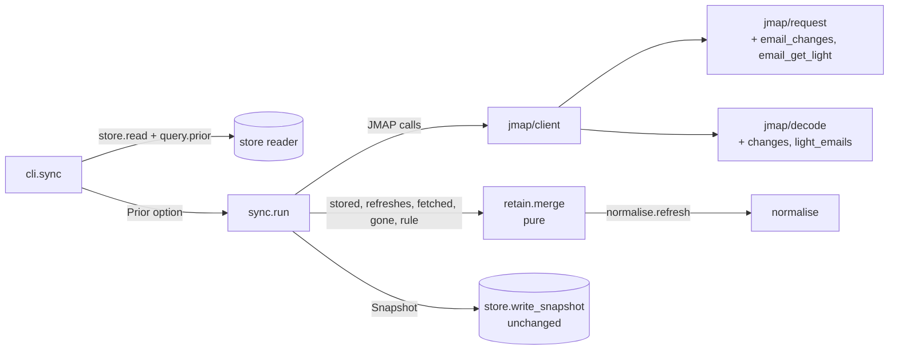
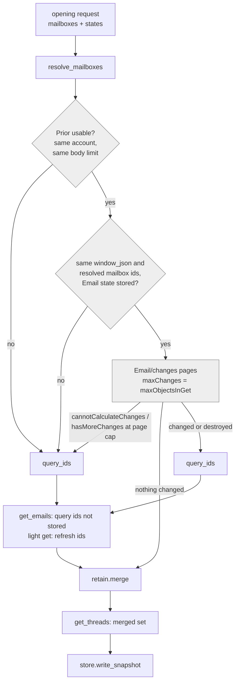
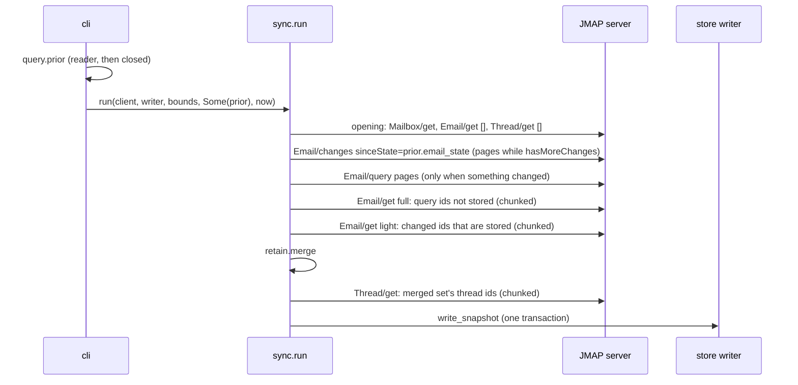

<!-- doctrine:section sec-1 -->
## 1. Design Problem

Screwtape mirrors a bounded window of one Fastmail account into SQLite
(SL-001, "M1"). Every run is a **full sync**: it asks `Email/query` for the
window's ids, fetches every one of them with its bodies, and replaces the
store in one transaction. An unchanged mailbox still costs every body, every
run.

SL-002 ("M2") adds an **incremental sync**. JMAP (RFC 8620/8621, the
protocol Fastmail speaks) can say what changed since a state token
(`Email/changes`). Email content is immutable; only an Email's mailboxes
(`mailboxIds`) and flags (`keywords`) change. So a run needs bodies only for
messages it has never stored, and a cheap metadata refresh for the rest.

It also separates **retention** from the **fetch window**. The window
(`mailboxes`, `max_age_days`, `max_messages`) is what `Email/query` asks
for; a new optional `retain_messages` is how many messages the store keeps.

What changes, in one line each:

- `Email/query` still decides which messages are in the window; it is
  skipped only when `Email/changes` reports nothing.
- `Email/changes` decides which stored messages need a light refresh
  (`mailboxIds`, `keywords`).
- One pure merge, `screwtape/retain`, builds the retained set for both paths.
- The store write is unchanged: one `store.write_snapshot` per run.

**Boundary.** In scope: the upstream half of satan:RFC-020's `changes` (the
mirror asking JMAP what changed). Out of scope: `Email/queryChanges`,
`Mailbox/changes`, the consumer cursor (M3), schema changes, new security
mechanisms, push.

<!-- doctrine:section sec-2 -->
## 2. Current State

`sync.run` (`src/screwtape/sync.gleam:61`) runs these stages in order. Each
stage after the opening request threads one `Client`, which carries the byte
budget left (`max_total_bytes`).

1. **Opening request:** `Mailbox/get`, plus an `Email/get` and a
   `Thread/get` with no ids. Those two return only the Email and Thread
   states, taken before any fetch (ISS-001).
2. `resolve_mailboxes` turns the configured mailbox entries (role, else
   exact name) into mailbox ids.
3. **Phase 1, `query_ids`:** `Email/query` pages under one `queryState`,
   newest `receivedAt` first, at most `max_messages` ids and `max_pages`
   pages.
4. **Phase 2, `get_emails`:** a full `Email/get` over those ids, in chunks of
   the session's `maxObjectsInGet`, checked by `only_requested` and
   `all_answered`, then `normalise.message`.
5. `get_threads` over the messages' distinct thread ids.
6. A `model.Snapshot`, committed by `store.write_snapshot`. That deletes
   every row and inserts the snapshot in one transaction (DEC-008).

The store already holds what an incremental run needs, with no schema
change:

- the per-type JMAP states (`type_state`, DEC-007);
- `window_json`, the config window the snapshot was taken with;
- the `query_state` row;
- each body's `max_body_value_bytes`.

`store/query.message` rebuilds a whole `model.Message` from its rows.

The read verbs (`list`, `read`, `thread`) read through `store.read` and are
unaffected.

<!-- doctrine:section sec-3 -->
## 3. Forces & Constraints

- **POL-001 (required): one implementation per behaviour.** Both paths share
  the window selection (`query_ids`), the fetches (`get_emails`,
  `get_threads`), one merge and one writer. New tests extend `test/support`.
- **DEC-008 (atomicity).** A run commits everything or nothing. A failed run
  leaves the store as it was, and the next run retries from the committed
  state.
- **ISS-001 (state before fetch).** The stored Email state must predate
  every fetch that it vouches for. A change that lands mid-run is then
  reported again, not lost.
- **Bounds.** `max_pages` bounds each paged phase, and `max_total_bytes`
  bounds the run. Nothing is retried within a run.
- **Fastmail behaviour, probed (EVD-001):**
  - `Email/changes` pages through intermediate `newState` values with
    `hasMoreChanges`;
  - an invalid or outdated `sinceState` gives the method error
    `cannotCalculateChanges`;
  - a mailbox move is reported in `updated`.
  - Overlap across pages was not exercised, so the client unions pages
    defensively.
- **Posture: rigorous simplicity.** No new store write code and no new
  harness. The security mechanisms from SL-001 are reused unchanged.

<!-- doctrine:section sec-4 -->
## 4. Guiding Principles

1. **The server decides membership.** Only `Email/query` says which messages
   are in the window, so the local result cannot drift from what a full
   sync would select.
2. **Changes decide refresh, never membership.** `Email/changes` says which
   stored messages need a light refresh, and whether a query is needed at
   all.
3. **Bodies once.** A body is fetched only for a message in the window that
   the store has never held. Stored messages get only `mailboxIds` and
   `keywords`.
4. **Pure core, thin shell.**
   - The merge is a pure function over values.
   - `sync.run` takes the stored state as a value (`Prior`) and never reads
     the store.
   - The CLI loads it.
5. **Fallback, not failure.** When the incremental path cannot be trusted,
   the run falls back to the full path and says why. Every other error fails
   the run, as in M1.

<!-- doctrine:section sec-5-1 -->
## 5. Proposed Design

### 5.1 System Model

Which module owns what. Arrows are calls or data handed over. The new pieces
are `retain`, `Prior` and the light and changes calls.



- **`cli`** opens a reader, loads the `Prior` with `query.prior`, and
  closes the reader before opening the writer. A missing store
  (`no_snapshot`) means no `Prior`; any other read error fails the run.
- **`sync`** checks whether the `Prior` is usable, chooses the path, makes
  every JMAP call, calls `retain.merge`, and builds the `Snapshot`. It never
  touches SQLite except through the writer it is handed, as today.
- **`retain`** (new) is pure. It takes no I/O and no `Client`.
- **`normalise`** owns how keywords become `is_seen` and `is_flagged`. Both
  `normalise.message` and the new `normalise.refresh` use one helper for it
  (POL-001).

One run, both paths. The paths differ only in the shaded decisions:



**Refresh ids:**
- **full:** every stored id;
- **incremental:** the changed ids that are stored.

A changed id that is neither stored nor in the query is ignored: it is
outside the window.

<!-- doctrine:section sec-5-2 -->
### 5.2 Interfaces & Contracts

#### Configuration (DEC-024)

`config.Window` gains one field:

```gleam
pub type Window {
  Window(
    mailboxes: List(String),
    max_age_days: Option(Int),
    max_messages: Option(Int),
    retain_messages: Option(Int),   // new
  )
}
```

- **Decoding:** `retain_messages` is an optional, nullable field (absent
  means `None`).
- **Validation:** it must be positive when set (`non_positive:retain_messages`).
  When `max_messages` is also set it must be at least that value
  (`retain_below_max_messages`).
- **`window_json`** encodes it as a fourth key, so a change to it changes
  `window_json`. The first M2 run therefore sees a mismatch against M1's
  three-key string and takes one full run (`window_changed`). This is
  harmless, and the README says so.
- **Home Manager:** `window.retainMessages`, `types.nullOr types.ints.positive`,
  default `null`.

#### The `Prior` (model)

```gleam
// model.gleam — the committed store, as a value sync can reason about.
pub type Prior {
  Prior(
    account_id: String,
    email_state: String,          // type_state 'Email'
    window_json: String,
    mailboxes: List(Mailbox),
    query: QueryState,
    messages: List(Message),
  )
}
```

`store/query.prior(tx) -> Result(Prior, Error)` builds it from existing
reads:

- `account_id`;
- the `type_state` and `sync` rows;
- a `query_state` row reader (new, small);
- `mailboxes`;
- every message id, each rebuilt with `message`.

When the store has no snapshot it returns `Store("no_snapshot")`.

#### `sync.run`

```gleam
pub type Bounds {
  Bounds(window: config.Window, max_pages: Int, max_body_bytes: Int)
}

pub type Mode { Incremental  Full }

pub fn run(
  client: Client,
  writer: Writer,
  bounds: Bounds,
  prior: Option(model.Prior),     // new
  now: Timestamp,
) -> Result(Summary, Error)
```

`Summary` gains `mode: Mode` and `fallback_reason: Option(String)`, rendered
by `cli.data` as `"mode": "incremental" | "full"` and
`"fallback_reason": null | "<reason>"`. A full run with no prior at all
reports `no_state`.

| fallback_reason | when |
|---|---|
| `no_state` | no `Prior`, or it is unusable: another account, or a stored body fetched under another `max_body_bytes` |
| `window_changed` | `window_json` differs, or the configured entries resolve to other mailbox ids than they do against the `Prior`'s mailboxes |
| `cannot_calculate_changes` | `Email/changes` answers the method error `cannotCalculateChanges` |
| `too_many_changes` | `hasMoreChanges` is still true after `max_pages` pages |

#### JMAP additions (`jmap/request`, `jmap/decode`)

```gleam
// request.Method gains EmailChanges -> "Email/changes"
pub fn email_changes(account_id, since_state, max_changes, call_id) -> Invocation
// Email/get with properties ["id", "mailboxIds", "keywords"], no body values
pub fn email_get_light(account_id, ids, call_id) -> Invocation

// decode
pub type ChangesPage {
  ChangesPage(new_state: String, has_more: Bool,
              created: List(String), updated: List(String), destroyed: List(String))
}
pub fn email_changes(response) -> Result(ChangesPage, Error)
pub type LightPage {
  LightPage(lights: List(normalise.Light), state: String, not_found: List(String))
}
pub fn light_emails(response) -> Result(LightPage, Error)
```

`normalise.Light` is `Light(id, mailbox_ids, keywords)`.
`normalise.refresh(message, light, state) -> Message` replaces
`mailbox_ids` and `keywords`, re-derives `is_seen` and `is_flagged` through
the same helper `normalise.message` uses, and sets `email_state` to the
light response's state: that response delivered the current mutable fields.

A `cannotCalculateChanges` reply reaches `sync` as
`Error(JmapMethod("Email/changes", "cannotCalculateChanges"))`. `sync`
catches only that error, matching the method by
`request.method_name(EmailChanges)` rather than a literal: I6, enforced by
`test/check_imports.gleam`, keeps every method name inside `request`. It
falls back with the `Client` it held before the call. The error response's
bytes are therefore not charged: a run may spend up to about twice
`max_total_bytes`, which is still bounded. This is accepted in DEC-026, and
the client API is unchanged.

#### The merge (`screwtape/retain`, DEC-025)

```gleam
pub type Rule {
  Rule(
    mailbox_ids: Set(String),     // the resolved window mailboxes
    keep: Option(Int),            // retain_messages, else max_messages
    after_ms: Option(Int),        // the age bound, only when retain_messages is None
  )
}

pub fn merge(
  stored: List(Message),
  refreshes: List(#(normalise.Light, String)),  // light, its response state
  fetched: List(Message),
  gone: Set(String),
  rule: Rule,
) -> List(Message)   // newest first
```

`retain` joins the purity rules in `test/check_imports.gleam` (I5): it may
import only `screwtape/model`, `screwtape/normalise` and `gleam_stdlib`.

`merge` runs these steps in order:
1. drop the `gone` ids from `stored`;
2. apply `refreshes` by id;
3. add `fetched`; on an id clash `fetched` wins;
4. keep the messages with at least one mailbox in `rule.mailbox_ids`;
5. keep those received at or after `after_ms`;
6. sort newest first by `normalise.compare_received`, reversed;
7. take `keep`.

#### Shared fetch loop

`get_emails` and the light get differ only in the request they build, the
decoder, and how they map a page. Their chunking and checks are one function:

```gleam
fn get_chunked(client, ids, chunk_size, invoke, decoder, returned_ids)
  -> Result(#(Client, List(page)), Error)
```

It builds on `in_chunks`, `only_requested` and `all_answered`, so there is no
second copy of the get loop (POL-001).

<!-- doctrine:section sec-5-3 -->
### 5.3 Data, State & Ownership

- **Schema:** unchanged. M2 reads columns M1 already writes.
- **What each run writes:**

  | row | full run | incremental run |
  |---|---|---|
  | `type_state` Email | the opening request's state | the last `Email/changes` `newState` |
  | `type_state` Mailbox, Thread | the opening request's states | the opening request's states |
  | `query_state` | the settled query | the settled query, or the `Prior`'s when nothing changed |
  | `sync.window_json` | the current window | the current window |
  | messages | `retain.merge` output | `retain.merge` output |
  | threads | `Thread/get` over the merged set's distinct thread ids | same |

- **Per-message `email_state`:**
  - a fully fetched message: its `Email/get` page's state, as in M1;
  - a refreshed message: its light page's state;
  - an untouched message: unchanged.
- **Ownership:**
  - only `cli` reads the store before a run;
  - only `store.write_snapshot` writes it;
  - `sync` owns every decision in between and holds no state across runs
    beyond the committed store.
- **Size:** the store holds at most `retain_messages` messages (else
  `max_messages`), at about 12 KB each today. Every run rewrites all of them
  locally; that cost is accepted in the scope.

<!-- doctrine:section sec-5-4 -->
### 5.4 Lifecycle, Operations & Dynamics

#### One incremental run with changes

What crosses the network, in order. Each request is its own HTTP exchange
charged to the one budget.



**When nothing changed,** the run sends only the opening request,
`Email/changes` (one page) and `Thread/get`. It merges with no new input, so
only the age bound can remove messages, writes a fresh `synced_at`, and
carries the `Prior`'s query record.

#### Choosing the path

Pure, in `sync`, before any call past the opening request:

1. **No `Prior`,** or another account, or a stored body fetched under
   another `max_body_bytes`: full run without a `Prior` (`no_state`). Stored
   messages are neither refreshed nor kept, and everything in the window is
   fetched again.
2. **A different `window_json`, or different resolved mailbox ids:** full run
   with the `Prior` (`window_changed`). Every stored id is light-refreshed,
   so the retained tail survives a window change.
3. **Otherwise:** incremental. Two `Email/changes` outcomes fall back to a
   full run with the `Prior`:
   - the `cannotCalculateChanges` method error;
   - `hasMoreChanges` still true after `max_pages` pages.

   Both are reported by their reasons.

#### Accumulating changes

The pages are folded with `changed = (created ∪ updated) − destroyed`.
`destroyed` accumulates. The run keeps the last page's `newState`.

#### Ids per run

| set | full | incremental (something changed) |
|---|---|---|
| query ids | `query_ids` | `query_ids` |
| fetched in full | query ids − stored | query ids − stored |
| refreshed light | stored | changed ∩ stored |
| gone | `notFound` of either get | destroyed ∪ `notFound` of either get |

#### Failure and retry

Any error other than the two fallbacks fails the run before the write, as
in M1. The store and its Email state are untouched, and the next run starts
from the same committed state.

#### Operations

- The summary line on stdout (the journal) carries `mode` and
  `fallback_reason`.
- The README's sync section describes:
  - the two paths;
  - the one-off full run after the upgrade;
  - retention covering configured mailboxes only;
  - the bounded budget overspend on `cannotCalculateChanges`.

<!-- doctrine:section sec-5-5 -->
### 5.5 Invariants, Assumptions & Edge Cases

**Invariants**

- **I-M1 (window agreement, DEC-025).** After any committed run, the newest
  `max_messages` of the stored messages that pass the window filter (in a
  configured mailbox, and received within `max_age_days` when it is set)
  are the ids a full sync would select at the same server state. The one
  exception is ties on `receivedAt` at the boundary: the server's order
  there is unspecified, and locally the id breaks them.
  - It holds because every run that sees a change runs `Email/query`, and
    every run that sees none had nothing to change.
- **I-M2 (bodies once).** A body is fetched only for a query id the store
  does not hold, or for every query id when there is no usable `Prior`.
- **I-M3 (replay-safe state).** The stored Email state predates every
  fetch whose result is stored:
  - the opening state, or
  - an `Email/changes` `newState` returned before any `Email/get` of the
    run.

  A change landing mid-run is therefore reported again next run.
- **I-M4 (atomicity, DEC-008).** One `write_snapshot` per run. A run that
  fails, falls back and fails again, or exceeds its budget leaves the store
  byte-identical.
- **I-M5 (round trip).** For a committed store, `write_snapshot` of a
  snapshot rebuilt from `query.prior` leaves `store_dump` unchanged. This is
  what makes "rewrite every run" safe.

**Edge cases**

- **A message moved into the window from elsewhere** is reported as
  `updated` (EVD-001). It is new to the store and in the query, so it is
  fetched in full. If it is outside the top `max_messages`, it is not
  fetched: retention keeps, it never backfills.
- **A message moved out of the window** gets a light refresh whose
  `mailboxIds` fail the mailbox filter, so it is dropped.
- **Created then destroyed within one delta:** destroyed wins and nothing is
  fetched.
- **The same id across pages:** the union handles it.
- **A changed id outside the window** (an Archive message marked seen) is
  neither stored nor in the query, so it is ignored and costs nothing.
- **A deletion inside the top `max_messages`:** the run sees a change, so
  `Email/query` runs and the next-oldest message comes in. This is the
  backfill the GPT review showed was missing from DEC-022.
- **Clock advance with no changes:** only the age bound removes messages.
  The count cannot fall short of a full sync's, because a full sync would
  lose the same messages.
- **`retain_messages` with `max_age_days`:** retention ignores age, and I-M1
  counts only window-eligible messages.
- **Mailbox rename or role reassignment:** the resolved ids differ, so the
  run falls back (`window_changed`).

**Assumptions**

- Fastmail keeps enough change history that `cannotCalculateChanges` is
  rare. When it happens, it is handled by a full run.
- `maxObjectsInGet` is a reasonable `maxChanges`; the server may return
  fewer.

<!-- doctrine:section sec-6 -->
## 6. Open Questions & Unknowns

None blocking. All nine design inquiries are dispositioned
(`doctrine design tree SL-002`).

Not exercised live: the overlap of `created`, `updated` and `destroyed`
across pages (EVD-001, J3). The union makes the client indifferent to it,
and a fixture test covers it.

<!-- doctrine:section sec-7 -->
## 7. Decisions, Rationale & Alternatives

| record | decides | main alternative rejected |
|---|---|---|
| DEC-024 | `retain_messages`: optional, inside `window`, at least `max_messages`; absent means retention equals the window | a top-level field; retention by age |
| DEC-025 | one pure merge for both paths; I-M1 stated over window-eligible messages | SQL upsert, delete and trim in the store |
| DEC-026 | `Email/query` decides membership, `Email/changes` decides refresh; `Prior` validity; the fallbacks; the budget undercount | window selection from the changes alone (superseded DEC-023) |
| EVD-001 | Fastmail `Email/changes` behaviour, probed live | — |

Smaller choices made in drafting (operator-reviewed 2026-10-27):

- the `Prior` is loaded by `cli` through a short-lived reader;
- a body-limit change is detected from the stored bodies'
  `max_body_value_bytes`;
- `maxChanges` = `maxObjectsInGet`;
- one keyword-flag helper in `normalise`;
- `no_state` covers every unusable `Prior`;
- the first M2 run falls back once.

<!-- doctrine:section sec-8 -->
## 8. Risks & Mitigations

| risk | mitigation |
|---|---|
| The invariant breaks in a case nobody thought of | I-M1 is tested both against fixed expected ids and by an incremental-equals-full comparison over scripted server states (§ 9) |
| Rewriting the whole retained set every run grows costly | Bounded by `retain_messages` and all local; I-M5 pins correctness. Revisit only if measured |
| A large delta (a bulk mark-read) wedges the run on budget | A finite `maxChanges` and the page cap turn it into a `too_many_changes` fallback. A full run costs the query plus light gets, not bodies |
| `cannotCalculateChanges` undercounts the budget | Bounded at about twice `max_total_bytes`; documented (DEC-026) |
| `receivedAt` ties at the boundary order differently from the server | Accepted and documented; the tests avoid boundary ties except one that pins the local order |

<!-- doctrine:section sec-9 -->
## 9. Quality Engineering & Validation

No new harness and no mock library.
- **Fixture extensions:**
  - `request.Method.EmailChanges`;
  - `jmap_fixture.changes_response`, a `cannotCalculateChanges` error entry
    built on `error_entry`, and a light `Email/get` response;
  - `sync_fixture`: a changes step, `string_argument` (for `sinceState`), a
    public `type_state`, and `run_twice`.
- **`expect_unchanged`** is generalised to any seeded store, rather than
  adding a sibling helper.
- **`test/check_imports.gleam`** gains the `retain` purity rule (I5);
  `just check-imports` covers it.
- **The `opening_entries` length guard** (the one CHR-004 item absorbed)
  makes an opening-call mismatch fail loudly instead of truncating.

### Invariant → evidence

| invariant | test (in-process unless noted) |
|---|---|
| I-M1 | `deletion_backfills_test`: store `[A,B]`, server `[A,B,C]`, `max_messages` 2, A destroyed → `[B,C]` |
| I-M1 | `incremental_equals_full_test`: one scripted server history; ids and mutable fields after incremental runs equal a fresh full run's, alongside explicit expected ids |
| I-M1 | `age_out_without_changes_test`: no Email changes and a clock past `max_age_days` → the old message is dropped |
| I-M2 | `unchanged_account_three_requests_test`: `expect_calls` = opening, `Email/changes`, `Thread/get` |
| I-M2 | `outside_window_change_ignored_test`: an updated id neither stored nor in the query → no `Email/get` |
| I-M3 | `stored_email_state_test`: incremental stores the last `newState`; full stores the opening state |
| I-M4 | `failure_then_retry_test`: a get fails after changes → store unchanged; the next run starts from the old state |
| I-M5 | `store_test`: `write_snapshot` → `query.prior` → rebuilt snapshot → `write_snapshot` → identical dump |

### Further cases by module

- **`retain` (pure unit tests):**
  - gone ids are dropped;
  - a refresh moving a message out of the window drops it;
  - `fetched` wins on an id clash;
  - trim to `keep`;
  - the age bound applies only without `retain_messages`;
  - the order matches `compare_received`.
- **`sync`:**
  - paging accumulates, and destroyed wins across pages;
  - `cannotCalculateChanges` → full with the reason;
  - `hasMoreChanges` at the cap → `too_many_changes`;
  - a `window_json` change and a mailbox rename → `window_changed`;
  - another account and a body-limit change → `no_state`, everything
    refetched.
- **`config`:**
  - `retain_messages` is decoded, positive, and at least `max_messages`;
  - `window_json` carries it.
- **`jmap/decode`:** `email_changes` and `light_emails` shapes and errors.
- **`cli`:**
  - the summary carries `mode` and `fallback_reason`;
  - a missing store means no `Prior`.

### Test discipline

- No new subprocess or TLS tests; the boundary did not move.
- No vacuous shape-only tests.
- TDD scaffolding that duplicates a test above is pruned at phase end.

### Outside this repo

Live check: two consecutive syncs against the real account. The second
reports `mode: incremental` and fetches no `Email/get`. `gleam format
--check`, `just check` and `nix flake check` must be clean.

<!-- doctrine:section sec-10 -->
## 10. Code Impact

| path | change |
|---|---|
| `src/screwtape/config.gleam` | `Window.retain_messages`, decode, validate, `window_json` |
| `nix/module.nix` | `window.retainMessages` option |
| `src/screwtape/model.gleam` | `Prior` |
| `src/screwtape/store/query.gleam` | `prior`, `query_state` reader |
| `src/screwtape/jmap/request.gleam` | `Method.EmailChanges`, `email_changes`, `email_get_light` |
| `src/screwtape/jmap/decode.gleam` | `ChangesPage`, `email_changes`, `LightPage`, `light_emails` |
| `src/screwtape/normalise.gleam` | `Light`, `refresh`, a shared keyword-flag helper |
| `src/screwtape/retain.gleam` | new: `Rule`, `merge` |
| `src/screwtape/sync.gleam` | `Prior` parameter, path choice, changes paging, `get_chunked`, `Mode`, summary fields |
| `src/screwtape/cli.gleam` | load the `Prior`; render `mode` and `fallback_reason` |
| `test/check_imports.gleam` | the `retain` purity rule |
| `test/support/jmap_fixture.gleam`, `test/support/sync_fixture.gleam` | the extensions in § 9 |
| `test/screwtape/{retain,sync,store,config,cli}_test.gleam`, `test/screwtape/jmap/decode_test.gleam` | the tests in § 9 |
| `README.md` | the sync section (§ 5.4 Operations) |

Unchanged: `store.gleam`'s writer and schema, `jmap/client.gleam`, the read
verbs.
